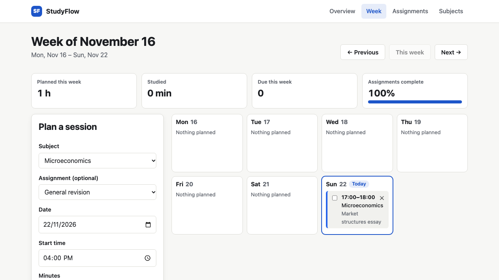
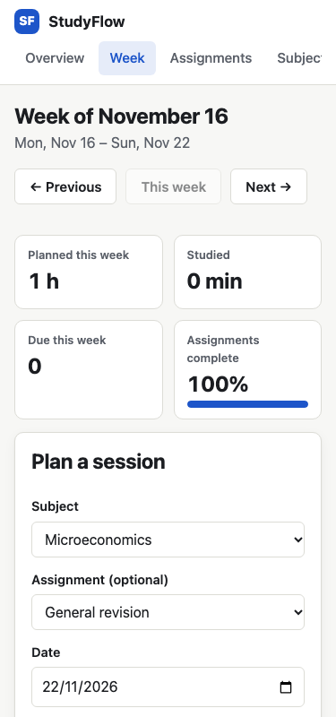
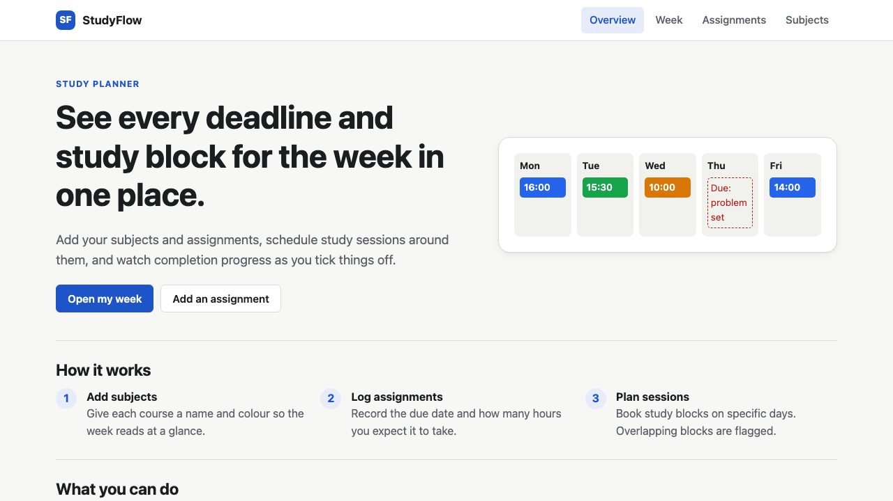

# StudyFlow

A weekly study planner. Create subjects, log assignments with due dates and time estimates, schedule study sessions, and track completion overall and per subject.



| Mobile | Landing |
| --- | --- |
|  |  |

## Run it

```bash
npm install
npm run dev        # http://localhost:5102
npm test           # Vitest unit + component workflow tests
npm run build      # type-check + production build
npm run test:e2e   # Playwright smoke test (run `npm run e2e:install` once if Chromium is missing)
```

## Main workflow

1. **Subjects** → add a subject (name + colour). New users are guided here from the empty Week/Assignments pages.
2. **Assignments** → add an assignment with a due date and estimated hours. Tick it off when complete.
3. **Week** → plan a session for a subject (optionally linked to an assignment) on a date, start time and duration. Overlapping sessions are rejected with a message naming the clash.
4. Tick sessions as studied. The stat tiles show planned vs studied time, items due this week and overall completion.

Demo content: on an empty Week or Assignments page choose **Load demo plan** (subjects are prefixed “Demo:”; dates are generated around the current week).

## States covered

- Empty: no subjects (guided start), no assignments, no sessions on a day.
- Validation: missing fields, invalid times, durations outside 15–480 minutes, sessions past midnight, overlapping sessions, duplicate subject names.
- Success: confirmation after adding a subject, assignment or session.
- Status: overdue / due today / due soon / completed badges.
- Destructive actions: deleting a subject asks for confirmation and explains that its assignments and sessions go with it.

## How it is built

- `src/lib/dates.ts` — local-date helpers (`YYYY-MM-DD`, Monday-start weeks) that avoid time-zone drift.
- `src/lib/plan.ts` — validation, overlap detection, due status, progress maths.
- `src/lib/demo.ts` — demo plan relative to today.
- State lives in `localStorage` under `studyflow:data`.

## Tests

- `src/lib/plan.test.ts` — week boundaries, month rollover, invalid dates, due status, overlap detection, validation, progress percentages.
- `src/App.test.tsx` — guided empty state, subject → assignment → completion, overlap rejection with demo data.
- `e2e/smoke.spec.ts` — the full new-user flow in Chromium including reload persistence and a 375px layout check.

## Limitations

- Sessions cannot be edited in place (delete and re-add instead) and cannot be dragged between days.
- No recurring sessions, reminders or calendar (ICS) export.
- Week starts on Monday; this is not configurable.
- Single device only — no accounts or sync.

## Future improvements

- Drag-and-drop rescheduling and in-place editing.
- Suggest sessions automatically from remaining estimated hours before each due date.
- ICS export so sessions can be added to a calendar app.
